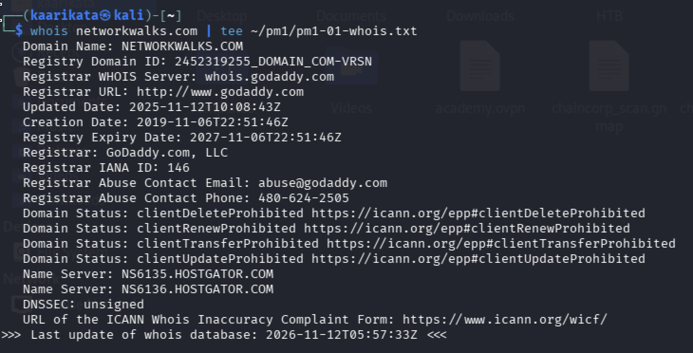
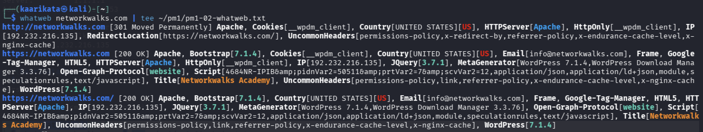
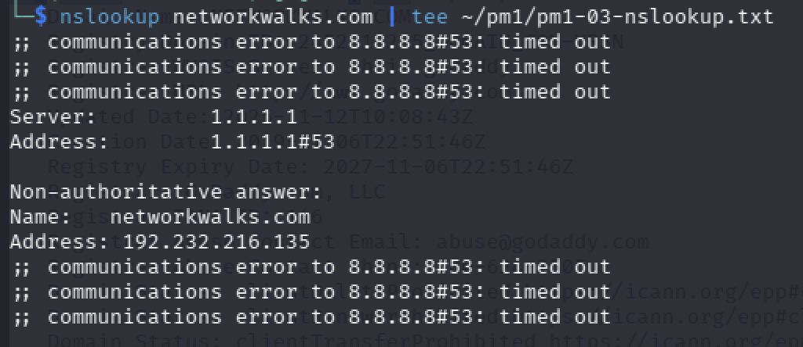
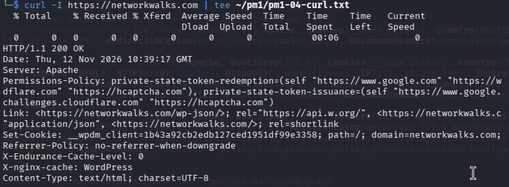
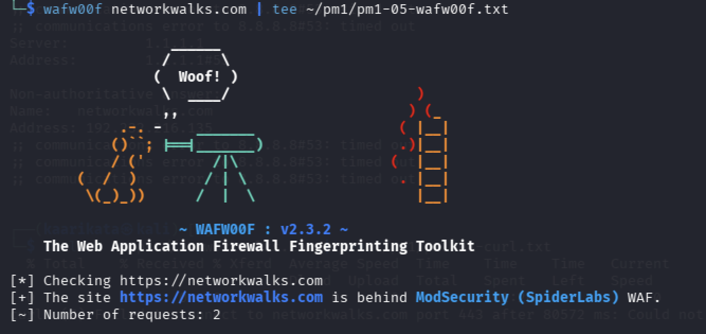
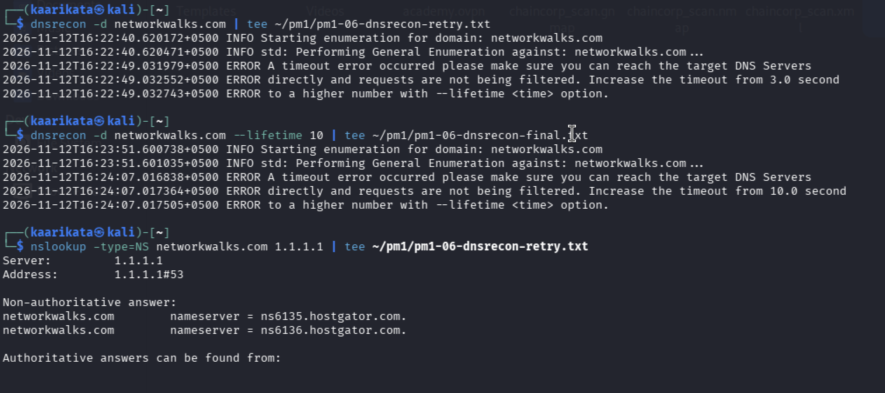

# W2-PM1 — Footprinting Evidence

This section contains screenshots of the six footprinting tools used during the project.

## 1. WHOIS

## 2. WhatWeb

## 3. NSLookup

## 4. cURL

## 5. WAFW00F

## 6. DNSRecon

