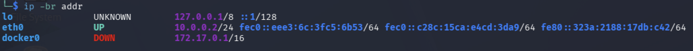
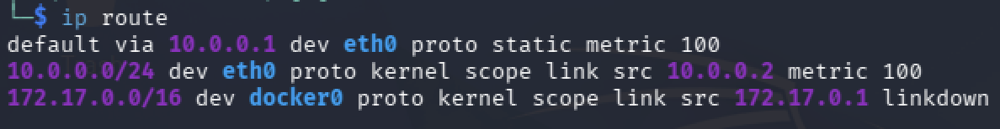
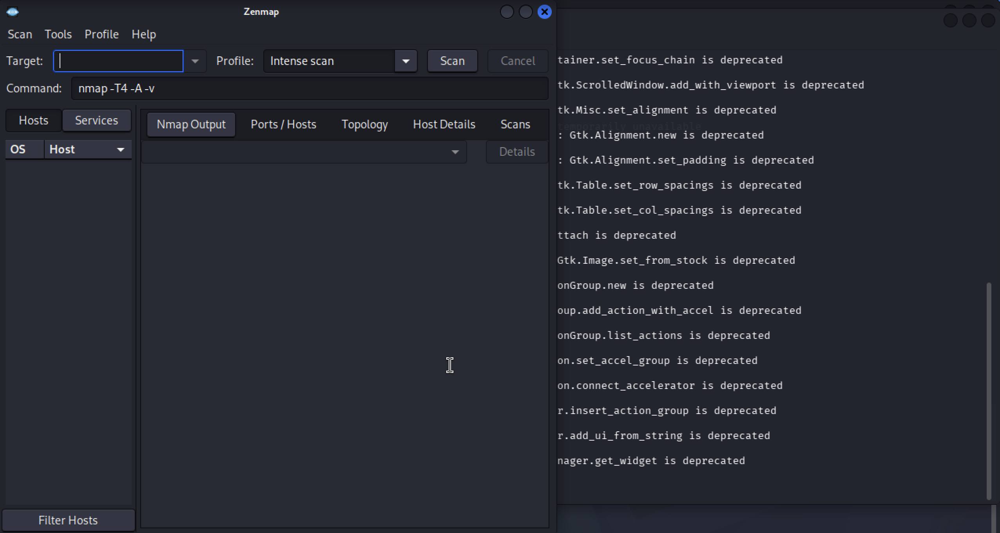
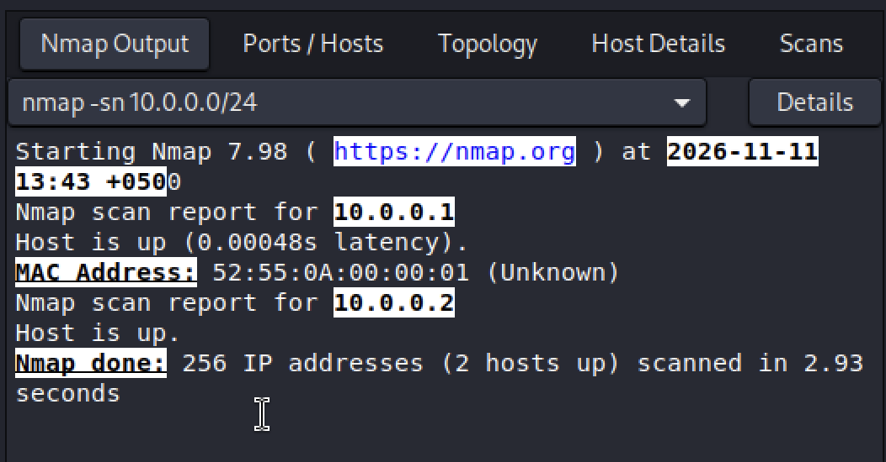
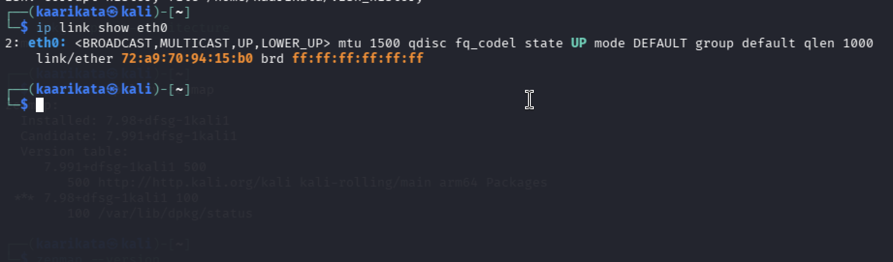
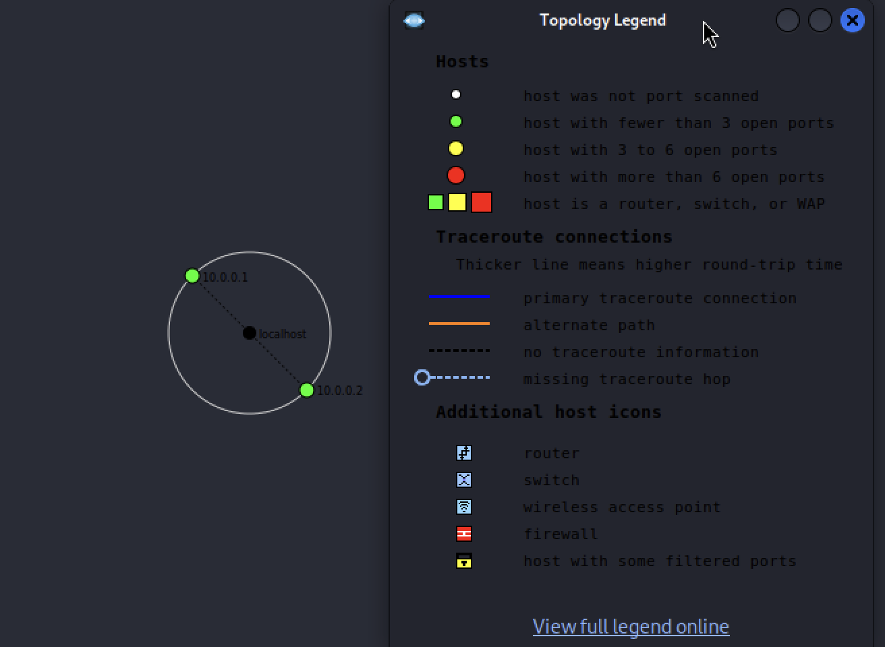

# W2-PM5 — Network Scanning Screenshots

This folder contains screenshots documenting the network scanning tasks performed using Zenmap in my Kali Linux ARM64 virtual machine running under UTM/QEMU.

## Evidence

| No. | Screenshot | Description |
|---|---|---|
| 01 | `01` | Local IP address and subnet identification using `ip -br addr` |
| 02 | `02` | Network routing information using `ip route` |
| 06 | `06` | Zenmap launch |
| 07 | `07` | Nmap Ping Scan results showing discovered live hosts |
| 08 | `08` | Kali Linux network interface MAC address using `ip link show eth0` |
| 09 | `09` | Network topology generated using Zenmap |

## 01 — Local IP Configuration

## 02 — Routing Table

## 06 — Zenmap Launch

## 07 — Ping Scan Results

## 08 — Kali Linux MAC Address

## 09 — Network Topology

